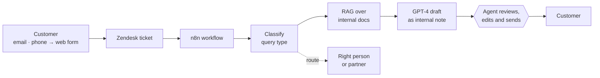
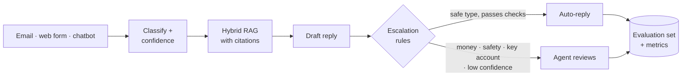

# AI After-Sales Support at an Educational-Robotics Startup

Case study of the AI after-sales operation I designed from scratch and prototyped at **Robotix**, a ~50-person startup that sells electronic, LEGO-style robotics kits for children. I worked there as **AI Engineer** from 09/2024 to 07/2025, reporting to the **CEO and COO**.

**Why.** Robotix sells through many channels at once: private schools (B2B), families (B2C), public-sector contracts and large retail chains. Every channel generates after-sales questions about orders, returns, warranty, faults, assembly and invoices, by email and by phone. As sales grew, the support team could not keep up: **too many tickets and response times too slow**. The goal was to absorb that growth without hiring at the same rate, while keeping every answer under human control.

> This repository contains **no code**. I designed the system and built a working demo of it in n8n, which is internal to the company. This page explains what I designed, the decisions behind it and the expected impact. It uses no internal data or documents.

## Highlights

| Block | What I did | Outcome |
|---|---|---|
| [1. Support strategy](#1-support-strategy) | Customer journey, resolution protocols and operating manuals for every sales channel | Every query type with an owner, a protocol and a reply template |
| [2. Partners & costs](#2-partners--costs) | Compared logistics providers and repair centres; negotiated their pricing | Kept current logistics providers; chose a repair centre in Madrid |
| [3. AI pipeline](#3-ai-pipeline) | Designed the pipeline (classify, retrieve, draft, route) and built a working demo in n8n | Human always in the loop |
| [4. Expected impact](#4-expected-impact) | Estimated cases resolved per person, before and after | **~5× more cases resolved per person** (estimate) |

---

## 1. Support strategy

*Why it matters:* AI cannot fix a process that does not exist. Before automating anything, each type of question needed a clear owner, a standard answer and an expected response time. That is also what the AI needed to learn from.

**What I did**
- Mapped the **customer journey** after purchase for each sales channel (schools, families, public sector, retail).
- Defined **resolution protocols** for the six most common query types: order status, returns, warranty, technical fault, assembly, invoicing.
- Wrote the **operating manuals**: reply templates per query type, target response times and which channel handles what.

**Retention before returns.** I designed a retention step: before accepting a return, the team member in charge of returns called the customer to see whether the problem could be solved so they could keep the product.

---

## 2. Partners & costs

*Why it matters:* after-sales is not only answering messages. A fault or a return turns into shipments and repairs, and those partners decide the real cost and speed of support.

**What I did**
- Compared **logistics providers** and **product repair centres** for the cases that needed a repair, on four criteria: **strategy, contracts, legal requirements and price**.
- Decision: keep the logistics providers already in place for shipments, and use a **repair centre in Madrid**.
- Negotiated the **pricing** with the providers: the repair centre charged a **fee per repaired unit plus shipping costs**.

---

## 3. AI pipeline

*Why it matters:* most tickets are repetitive and the answer is already in internal documents. An AI that finds that answer and writes the first draft removes most of the manual work, while a person keeps the final word.

**What I designed**, and built as a working demo in n8n:
- **Zendesk** as the CRM: every email becomes a ticket. Phone calls reached an automated message that sent callers to the web form, so they also became tickets and nothing stayed off the record.
- **n8n** workflows on each new ticket:
  1. **Classify** the query by type.
  2. **Retrieve** the relevant passages with **RAG** over internal documents in **Google Drive**: product documentation and the company's operating procedures.
  3. **Draft** a reply with **GPT-4** and post it as an **internal note** on the Zendesk ticket, so the agent works where they already work.
  4. **Route** the ticket to the right person.
- **Model choice.** I compared the LLM providers available at the time; OpenAI's GPT-4 gave the best answers, so I chose it.
- **Human in the loop, always.** In 2024 language models were not reliable enough to reply to customers on their own, so in the design the AI never sends anything: a person reviews, edits and sends every reply.

---

## 4. Expected impact

*Why it matters:* the target was to grow support without growing the team at the same pace.

| Metric | Estimate |
|---|---|
| Cases resolved per person | **~5× more** than before the AI pipeline |

The estimate comes from the presentation in which I proposed the system to the company.

---

## Limits

- **Draft-only by design.** In 2024 every reply needed a human, so the AI was meant to save writing time, never to close a ticket on its own.
- **Demo, not production.** I designed the system and built a working demo in n8n; this page does not describe a production rollout.
- **Estimated impact.** The ~5× figure is an estimate from my proposal, not a measured before/after result.
- **No public code.** The demo is internal and built in n8n, so this repository documents the design only.

---

## What I'd do today

*Why it matters:* models are now reliable enough to close the simple tickets on their own. The question is no longer "can the AI write a good draft?" but "which tickets can it close safely, and how do we prove it?". I would rebuild the system around that question.

| Then (2024) | Today |
|---|---|
| Every reply drafted, every reply reviewed | AI closes safe query types on its own; humans review only what the rules send them |
| Escalation decided case by case by the agent | **Explicit escalation rules** in a config file: low confidence or weak sources, refunds above a threshold, safety or legal topics, angry customer, B2B or public-sector account, customer asks for a person |
| Retrieval with default settings | **Hybrid search** (keywords + embeddings) and every answer **cites its sources** |
| Retention call designed by hand | The draft **suggests keep-instead-of-return** (partial refund or spare part) when the policy allows it, with a call script for the agent |
| Support only by email and phone | **Web chatbot** for self-service (assembly, FAQ, order status) that opens a ticket when it cannot help |
| Impact estimated | **Evaluation set** of labelled queries, run on every change |

**How I'd measure it**

| Metric | What it tells you |
|---|---|
| Classification accuracy / F1 per query type | Whether tickets reach the right flow |
| Drafts approved without edits | How much work the AI really removes |
| Tickets closed without a person | The real capacity gain |
| Missed escalations | The dangerous error: a case that needed a person and did not get one |
| Unnecessary escalations | The costly error: work sent to people for nothing |
| Answer faithfulness to sources | Whether the AI invents policy |
| Cost and latency per ticket | Whether it scales with the budget |

**Rollout:** start in draft mode for every type, switch a type to automatic only when its approved-without-edits rate and missed-escalation rate pass a threshold, and keep a person on everything involving money, safety or key accounts.

---

## Also at Robotix

I led the front-end and back-end of an internal web app that merged the commits of several external software vendors into **one version history**, on a local password-protected server, so the company could follow all the work while each vendor saw only its own.

---

## Stack

Zendesk · n8n · GPT-4 · RAG over internal documentation in Google Drive

## Author

**Carles Font** · Telecommunications Engineer (UPC) · [GitHub](https://github.com/carles-font-alavedra)
